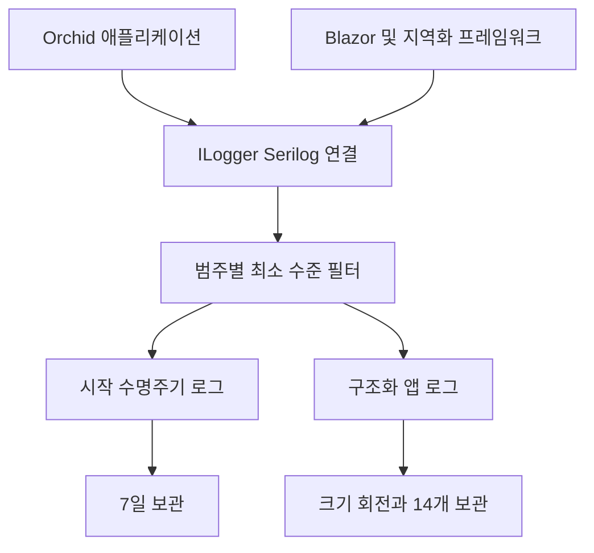
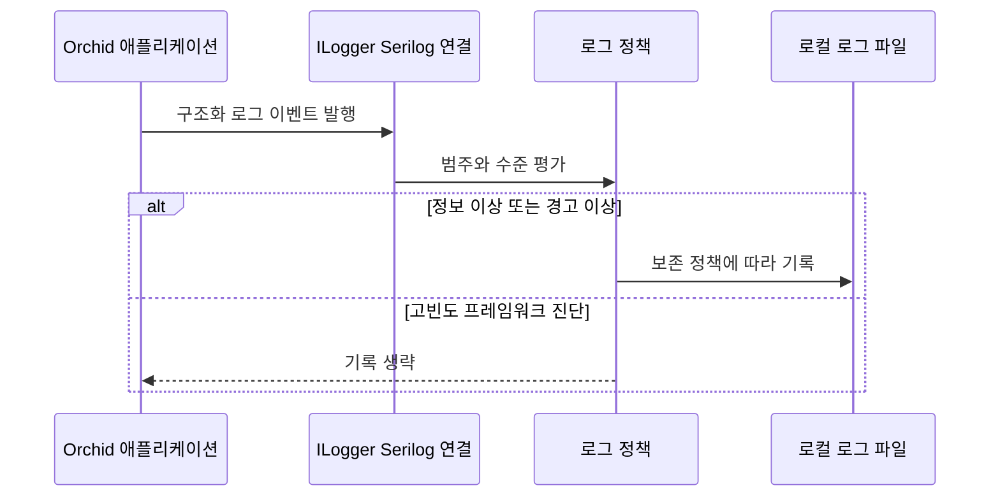

# Orchid Desktop 로그 신호 정책 설계

| 상태 | 최종 수정 | 관련 계획 | 구현 상태 |
| --- | --- | --- | --- |
| 초안 | 2026-11-20 | [261120_refac_logging-noise-control.md](../../lib/Garden.Harness/plans/ibocon/orchid-desktop/history/2611/W4/261120/261120_refac_logging-noise-control.md) | 구현 완료 |

## 문서 목적

Orchid Desktop의 영속 로그를 장애 분석에 필요한 신호로 제한한다. UI 렌더링과 단순 지역화 조회처럼 정상 동작 중 대량 발생하는 프레임워크 진단 이벤트는 콘솔과 파일에서 제외하되, 시작 단계·경고·오류와 최종 실패 원인은 보존한다.

## 설계 상태

목표 설계는 범주별 최소 수준과 유한한 파일 보존 한계를 갖는 단일 로그 정책이다. `DesktopStartupLog`은 `Information` 기본 수준과 프레임워크 `Warning` 재정의를 적용하며, `MauiProgram`은 provider 범주 필터를 등록한다. 구현 및 단위 테스트 근거는 [관련 계획](../../lib/Garden.Harness/plans/ibocon/orchid-desktop/history/2611/W4/261120/261120_refac_logging-noise-control.md)에 기록한다.

## 설계 목표

1. 기본 영속 로그 수준은 `Information`이며, 경고·오류·치명적 오류는 항상 보존한다.
2. `Renderer`와 `ResourceManagerStringLocalizer`의 정상 진단 이벤트는 `Warning` 미만에서 차단한다.
3. 일별 로그 파일은 크기 기준으로도 회전하며, 보관 개수는 유한하다.
4. 시작 실패는 예외 메시지 대신 단계와 예외 형식만 남기는 현재 비밀값 보호 계약을 유지한다.

## 시스템 경계

| 경계 | 책임 | 신뢰 수준 |
| --- | --- | --- |
| Orchid 애플리케이션 | 시작 단계와 업무 실패를 구조화 이벤트로 발행 | 신뢰 |
| Microsoft 및 Blazor 프레임워크 | 렌더링과 지역화 진단 이벤트를 발행 | 신뢰하되 고빈도 |
| `DesktopStartupLog` | Serilog 수준·범주·파일 보존 정책을 구성 | 신뢰 |
| `MauiProgram` 로깅 파이프라인 | `ILogger` 범주 필터를 모든 활성 provider에 적용 | 신뢰 |
| 로컬 로그 디렉터리 | 제한된 기간의 구조화 파일을 보관 | 로컬 사용자 데이터 |

## 구성요소

| 구성요소 | 책임 |
| --- | --- |
| `DesktopStartupLog` | Serilog의 기본 수준, source override, rolling sink 정책을 선언한다. |
| `MauiProgram` | 모든 `ILogger` provider에 프레임워크 범주 필터를 등록한다. |
| 시작 로그 sink | `Information` 이상 시작 수명주기를 7일 보관한다. |
| 구조화 앱 sink | `Information` 이상 이벤트를 10 MiB 단위로 회전하고 14개 보관한다. |

## 주요 흐름

## 설계 결정

### 전역 Debug 기록을 범주 기반 필터로 대체

- 문제·맥락: 전역 `Debug`는 Blazor component rendering과 resource lookup 같은 정상 이벤트를 반복 기록하여 사람이 읽는 출력과 구조화 파일을 모두 오염시킨다.
- 고려한 대안: 전역 `Warning`만 사용하면 Orchid의 정상 시작 신호가 사라지고, 개별 호출부에서 로그를 삭제하면 프레임워크 업데이트마다 누락 범주가 늘어난다.
- 결정: 기본 수준은 `Information`으로 두고 `Microsoft.AspNetCore.Components.RenderTree.Renderer`, `Microsoft.Extensions.Localization.ResourceManagerStringLocalizer`, 그 밖의 `Microsoft`·`System` 범주를 `Warning`으로 제한한다. 필요한 일시 진단은 영속 정책을 바꾸지 않는 debugger 세션에서만 활성화한다.
- 트레이드오프: 프레임워크 내부 Debug 정보가 기본 로그에 남지 않아 프레임워크 결함 분석 시 재현 세션에서 명시적으로 진단 수준을 올려야 한다.
- 상태: 제안

### 일별 보존과 크기 회전을 함께 적용

- 문제·맥락: 보관 개수만 제한하면 하루에 비정상적으로 많은 이벤트가 발생한 경우 하나의 파일이 무제한 커질 수 있다.
- 고려한 대안: 보관 기간만 더 짧게 하면 폭주 당일의 디스크 사용량을 막지 못하며, 모든 로그를 삭제하면 시작 실패 분석 근거가 사라진다.
- 결정: 구조화 앱 로그에 10 MiB 파일 크기 상한과 size rolling을 적용하고 최대 14개 파일만 보관한다. 시작 수명주기 로그의 7일 보관은 유지한다.
- 트레이드오프: 회전 시 동일 일자에 여러 파일이 생기며, 오래된 정보는 14개 파일을 넘으면 사라진다.
- 상태: 제안

## 오류 처리

| 실패 | 처리 |
| --- | --- |
| 로그 디렉터리 생성 또는 sink 초기화 실패 | 기존처럼 예외 형식만 debugger 출력에 남기고 앱 시작 실패를 유발하지 않는다. |
| 범주 필터 구성 오류 | 단위 테스트로 최소 수준과 두 고빈도 범주의 차단 계약을 검증한다. |
| 파일 크기 한계 도달 | Serilog rolling sink가 다음 파일로 회전하고 보관 한도를 적용한다. |
| 시작 단계 오류 | 단계와 예외 형식을 `Error`로 기록하며 예외 메시지는 기록하지 않는다. |

## 관련 문서

- [로그 소음 제어 리팩터링 계획](../../lib/Garden.Harness/plans/ibocon/orchid-desktop/history/2611/W4/261120/261120_refac_logging-noise-control.md)
- [DesktopStartupLog.cs](../../src/Service/DesktopStartupLog.cs)
- [MauiProgram.cs](../../src/MauiProgram.cs)
