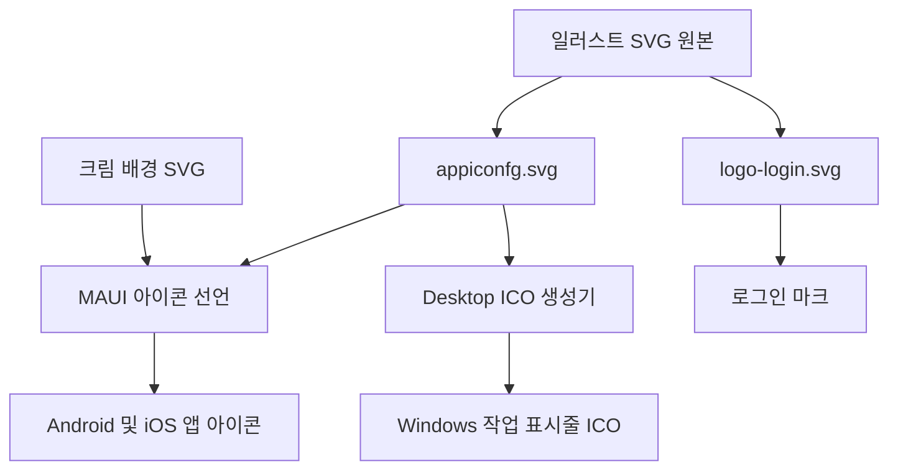
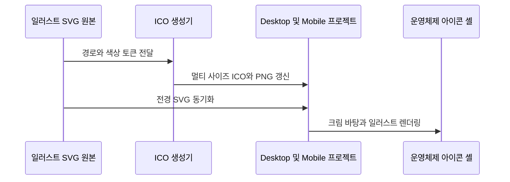

# Orchid 앱 아이콘 설계

| 상태 | 최종 수정 | 관련 계획 | 구현 상태 |
| --- | --- | --- | --- |
| 검토중 | 2026-11-21 | [261121_refac_icon-outline-clarity.md](../../lib/Garden.Harness/plans/ibocon/orchid-desktop/planning/261121_refac_icon-outline-clarity.md), [261121_refac_mobile-icon-outline-clarity.md](../../lib/Garden.Harness/plans/ibocon/orchid-mobile/planning/261121_refac_mobile-icon-outline-clarity.md) | 로그인 마크와 같은 일러스트 통일 및 외곽선 선명도 개선 적용 완료(Desktop·Mobile 계약 테스트 통과), 실기기 확인 대기 |

## 문서 목적

Orchid의 Windows, Android, iOS 앱 아이콘과 로그인 마크를 하나의 가벼운 손그림 난초로 통일한다. 이 문서는 제품 기능이 아닌 작은 크기에서의 식별성과 브랜드 인상을 다룬다.

## 설계 상태

목표 설계는 모든 표면(로그인, 작업 표시줄, Android, iOS)이 하나의 다색 일러스트 SVG 원본을 공유하는 것이다. 현재 구현은 작업 표시줄 ICO가 로그인 마크와 같은 일러스트를 쓰도록 통일되었으나, 외곽선이 가늘고 연해 작은 크기에서 흐리게 보이며 SVG와 ICO 생성기가 좌표를 따로 들고 있다. 이 문제의 해소는 위 관련 계획이 소유한다.

## 설계 목표

1. 44px부터 읽히는 둥근 세 꽃잎, 작은 프릴 설판, 노란 화심만 남긴다.
2. 잎, 줄기, 잎맥, 그라데이션처럼 작은 크기에서 복잡해지는 요소를 사용하지 않는다.
3. 웜 크림 바탕과 진한 웜 브라운 윤곽(`#6D5443`)을 고정하고, 윤곽선은 1024 기준 30 단위 이상으로 유지한다.
4. 모든 표면은 하나의 SVG 경로 원본에서 파생되어 표면 간 디자인이 어긋나지 않는다.
5. 32px 이하에서는 화심 세부를 줄여 중심부와 세 꽃잎의 실루엣을 식별할 수 있어야 한다.
6. Android 전경은 108dp 중 66dp 안전영역(약 61%)을 넘지 않는다.

## 시스템 경계

| 경계 | 책임 | 신뢰 수준 |
| --- | --- | --- |
| 일러스트 SVG 원본 | 꽃잎 경로, 색상 토큰, 윤곽선 굵기를 정의 | 신뢰 |
| MAUI 아이콘 선언 | 크림 바탕과 전경 스케일로 조합하며 Android 안전영역 한도를 지킴 | 신뢰 |
| Desktop ICO 생성기 | SVG 경로를 읽어 16~256px 래스터 ICO를 결정론적으로 생성 | 신뢰 |
| 로그인 화면 | 완성된 크림 타일을 브랜드 마크로 표시 | 신뢰 |

## 구성요소

| 구성요소 | 책임 |
| --- | --- |
| `appicon.svg` | `#F1E4CA` 크림 바탕을 제공한다. |
| `appiconfg.svg` | 타일 없이 일러스트 전경만 제공하며 `logo-login.svg`와 같은 경로·토큰을 쓴다. |
| `logo-login.svg` | 크림 타일 위 일러스트를 제공한다. |
| `New-OrchidBrandVisualAssets.ps1` | `appiconfg.svg`의 경로를 읽어 ICO와 PNG를 생성한다. |

## 주요 흐름

## 설계 결정

### 여백 우선의 단순 난초 마크

- 문제·맥락: 사실적인 난초와 큰 꽃잎은 작은 앱 아이콘에서 부담스럽고 주변 앱과 경쟁한다.
- 고려한 대안: 식물학적 잎과 줄기를 유지하는 상세 삽화, 단색 세 꽃잎 기호를 고려했다.
- 결정: 잎과 줄기를 제거하고, 둥근 세 꽃잎과 작은 프릴 설판 및 노란 화심만 얇은 브라운 윤곽으로 그린다. MAUI 전경 스케일은 64%로 고정한다.
- 트레이드오프: 실제 난초의 세부 묘사는 줄어들지만, 크기 변화와 플랫폼 마스크에 안정적이다.
- 상태: 승인

### 작업 표시줄 전용 단색 심벌

- 문제·맥락: 완성 타일을 32px 작업 표시줄에 축소하면 타일·윤곽선·프릴이 경쟁해 난초의 식별성이 떨어진다.
- 고려한 대안: 완성 타일을 계속 축소하거나, 크림 타일을 없애거나, 단색 심벌을 별도로 제공하는 방식을 고려했다.
- 결정: 작업 표시줄과 런처에는 크림 타일 위 단색 보라 난초 심벌을 쓰고, 로그인에는 완성 타일을 유지한다.
- 트레이드오프: 두 자산은 동일한 색상·세 꽃잎 실루엣을 공유하지만 바이트 단위로 같지 않다.
- 상태: 대체됨 (아래 "단일 일러스트 원본 통일"로 대체)

### 단일 일러스트 원본 통일

- 문제·맥락: 작업 표시줄만 단색 보라 글리프여서 앱 내 로고와 전혀 다른 디자인으로 보였다. ICO 생성기와 SVG가 서로 다른 좌표를 가져 표면 간 모양도 조금씩 달랐다.
- 고려한 대안: 단색 글리프를 로그인까지 확대하는 방법, 표면별로 따로 그리는 방법, 일러스트 하나를 모든 표면의 원본으로 쓰는 방법을 비교했다.
- 결정: 다색 일러스트를 단일 원본으로 쓰고, ICO 생성기는 `appiconfg.svg`의 경로를 읽어 래스터를 만든다.
- 트레이드오프: 작은 크기 전용 단순화가 필요해져 생성기에 크기별 분기가 생긴다.
- 상태: 승인

### 진한 굵은 윤곽선

- 문제·맥락: 윤곽선이 1024 기준 16 단위의 밝은 갈색(`#A8796A`)이라 48dp 크기에서 1px 미만이 되어 꽃이 흐리게 보인다.
- 고려한 대안: 윤곽선 제거, 굵기만 증가, 굵기와 색을 함께 강화하는 방식을 비교했다.
- 결정: 윤곽선을 30 단위로 키우고 브랜드 잉크 `#6D5443`으로 바꾼다. ICO는 렌더 크기에서 최소 2px을 보장한다.
- 트레이드오프: 꽃잎 안쪽 면적이 줄고 인상이 조금 무거워진다.
- 상태: 제안

### 꽃잎 채도 상향

- 문제·맥락: 연분홍(`#E9B2B8`)과 연보라(`#D3BEDD`)는 크림 바탕(`#F1E4CA`)과 명도 차이가 작아 윤곽 외에는 구분되지 않는다.
- 고려한 대안: 현행 유지, 채도만 소폭 상향, 새 팔레트 도입을 비교했다.
- 결정: 분홍을 `#E58FA0`, 윗꽃잎 연보라를 `#BFA3DA`로 올리고 설판 `#A96C8E`과 화심 `#EDC261`은 유지한다.
- 트레이드오프: 손그림의 부드러운 인상이 약간 줄지만 브랜드 토큰 범위를 벗어나지 않는다.
- 상태: 제안

### 안전영역 안의 구성 재배치

- 문제·맥락: Android 안전영역은 이미 `ForegroundScale="0.84"`에서 난초 높이 약 60.5%로 한도에 가깝다. 따라서 전경 스케일을 키우는 방식으로는 꽃을 더 크게 만들 수 없다. 그러나 난초 경계 상자의 수직 중심이 512가 아닌 약 453이어서 위로 치우쳐 있다.
- 고려한 대안: 스케일 상향(안전영역 초과), 현행 유지, 스케일은 유지하고 수직 중앙 정렬과 좌우 꽃잎 확장을 적용하는 방식을 비교했다.
- 결정: `ForegroundScale`은 0.84로 유지하고, 일러스트 그룹을 아래로 59 단위 이동해 수직 중앙에 맞추며 좌우 꽃잎의 너비를 8% 넓힌다.
- 트레이드오프: 꽃잎 모양이 약간 넓어지며 Desktop·Mobile 계약 테스트의 경로 기대값이 바뀐다.
- 상태: 제안

### 작은 크기 단순화

- 문제·맥락: 16·24·32px ICO에서는 화심 윤곽과 설판 요철이 뭉개져 중심부가 얼룩으로 보인다.
- 고려한 대안: 모든 크기에 같은 렌더, 크기별 전용 SVG, 생성기 안의 크기별 분기를 비교했다.
- 결정: 32px 이하에서는 화심 윤곽선을 그리지 않고 채우기만 하며, 윤곽 굵기는 최소 2px로 둔다.
- 트레이드오프: 생성기에 크기별 분기가 생기지만 SVG 원본은 하나로 유지된다.
- 상태: 제안

## 오류 처리

| 실패 | 처리 |
| --- | --- |
| 일러스트가 단색 글리프로 되돌아감 | 계약 테스트가 `taskbar-orchid`와 단색 전경을 거부한다. |
| 윤곽선이 가늘거나 연해짐 | 계약 테스트가 굵기 30 이상과 `#6D5443`을 검증한다. |
| 아이콘 스케일이나 안전영역이 달라짐 | Desktop과 Mobile 프로젝트 선언 계약이 실패한다. |
| Windows ICO와 SVG가 어긋남 | 생성기가 SVG 경로를 읽고, 계약 테스트가 생성기의 하드코딩 좌표를 거부한다. |
| ICO에 필요한 크기가 빠짐 | 계약 테스트가 16·24·32·48·64·256 항목을 검증한다. |

## 관련 문서

- [Desktop 시각 자산 계약](../../test/UnitTests/DesktopVisualAssetsContractTest.cs)
- [Mobile 앱 아이콘 계약](../../../Orchid.Mobile/test/UnitTests/MobileAppIconPackagingContractTest.cs)
- [Desktop 아이콘 생성기](../../scripts/New-OrchidBrandVisualAssets.ps1)
- [Android adaptive 아이콘 안전영역 계획](../../lib/Garden.Harness/plans/ibocon/orchid-mobile/history/2611/W4/261120/261120_fix_android-adaptive-icon-safe-zone.md)
