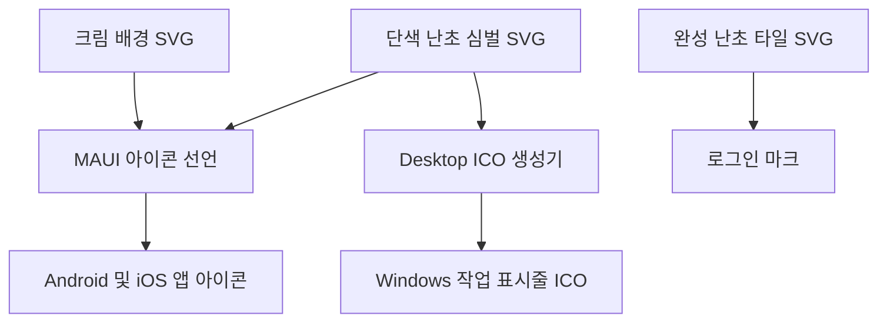
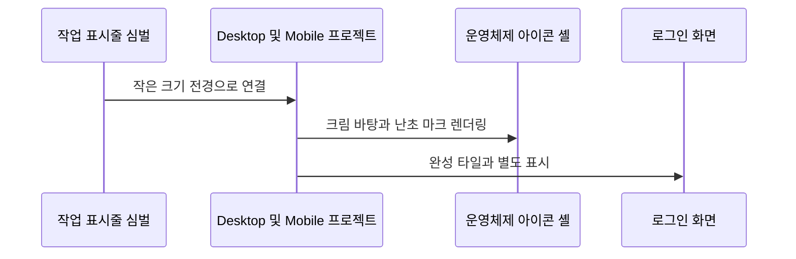

# Orchid 앱 아이콘 설계

| 상태 | 최종 수정 | 관련 계획 | 구현 상태 |
| --- | --- | --- | --- |
| 검토중 | 2026-11-20 | [261120_refac_taskbar-icon-clarity.md](../../lib/Garden.Harness/plans/ibocon/orchid-desktop/planning/261120_refac_taskbar-icon-clarity.md) | 작업 표시줄 전용 심벌 적용 대기 |

## 문서 목적

Orchid의 Windows, Android, iOS 앱 아이콘과 로그인 마크를 하나의 가벼운 손그림 난초로 통일한다. 이 문서는 제품 기능이 아닌 작은 크기에서의 식별성과 브랜드 인상을 다룬다.

## 설계 상태

목표 설계는 로그인용 완성 아이콘 타일과 작업 표시줄용 단순 심벌을 구분한다. `appicon.svg`는 공통 배경을, 작업 표시줄 전경은 단색 난초 심벌을, `logo-login.svg`는 완성된 크림 타일을 소유한다.

## 설계 목표

1. 44px부터 읽히는 둥근 세 꽃잎, 작은 프릴 설판, 노란 화심만 남긴다.
2. 잎, 줄기, 잎맥, 그라데이션처럼 작은 크기에서 복잡해지는 요소를 사용하지 않는다.
3. 웜 크림 바탕, 먼지 낀 핑크와 라벤더 꽃잎, 얇은 웜 브라운 윤곽을 고정한다.
4. 작업 표시줄 심벌은 32px에서도 중심부와 세 꽃잎을 식별할 수 있어야 한다.

## 시스템 경계

| 경계 | 책임 | 신뢰 수준 |
| --- | --- | --- |
| 작업 표시줄 SVG 전경 | 단색 난초 심벌과 안전 여백을 정의 | 신뢰 |
| MAUI 아이콘 선언 | 크림 바탕과 64% 안전 여백으로 조합 | 신뢰 |
| Desktop ICO 생성기 | Windows 작업 표시줄용 래스터 ICO를 같은 마크로 생성 | 신뢰 |
| 로그인 화면 | 완성된 크림 타일을 브랜드 마크로 표시 | 신뢰 |

## 구성요소

| 구성요소 | 책임 |
| --- | --- |
| `appicon.svg` | `#F1E4CA` 크림 바탕을 제공한다. |
| `appiconfg.svg` | 작은 크기용 단색 난초 심벌을 제공한다. |
| `logo-login.svg` | 크림 타일 위 손그림 난초를 제공한다. |
| `New-OrchidBrandVisualAssets.ps1` | Windows ICO를 같은 단순 마크로 생성한다. |

## 주요 흐름

## 설계 결정

### 여백 우선의 단순 난초 마크

- 문제·맥락: 사실적인 난초와 큰 꽃잎은 작은 앱 아이콘에서 부담스럽고 주변 앱과 경쟁한다.
- 고려한 대안: 식물학적 잎과 줄기를 유지하는 상세 삽화, 단색 세 꽃잎 기호를 고려했다.
- 결정: 잎과 줄기를 제거하고, 둥근 세 꽃잎과 작은 프릴 설판 및 노란 화심만 얇은 브라운 윤곽으로 그린다. MAUI 전경 스케일은 64%로 고정한다.
- 트레이드오프: 실제 난초의 세부 묘사는 줄어들지만, 크기 변화와 플랫폼 마스크에 안정적이다.
- 상태: 승인

### 작업 표시줄 전용 단색 심벌

- 문제·맥락: 완성 타일을 32px 작업 표시줄에 축소하면 타일·윤곽선·프릴이 경쟁해 난초의 식별성이 떨어진다.
- 고려한 대안: 완성 타일을 계속 축소하거나, 크림 타일을 없애거나, 단색 심벌을 별도로 제공하는 방식을 고려했다.
- 결정: 작업 표시줄과 런처에는 크림 타일 위 단색 보라 난초 심벌을 쓰고, 로그인에는 완성 타일을 유지한다.
- 트레이드오프: 두 자산은 동일한 색상·세 꽃잎 실루엣을 공유하지만 바이트 단위로 같지 않다.
- 상태: 제안

## 오류 처리

| 실패 | 처리 |
| --- | --- |
| 작업 표시줄 심벌이 복잡해짐 | 단위 계약 테스트가 단색·세 꽃잎·최소 안전 여백을 검증한다. |
| 아이콘 스케일이 달라짐 | Desktop과 Mobile 프로젝트 선언 계약이 실패한다. |
| Windows ICO가 오래된 마크를 사용함 | 생성기 계약과 ICO 재생성으로 동기화한다. |

## 관련 문서

- [Desktop 시각 자산 계약](../../test/UnitTests/DesktopVisualAssetsContractTest.cs)
- [Mobile 앱 아이콘 계약](../../../Orchid.Mobile/src/Mobile/test/UnitTests/MobileAppIconPackagingContractTest.cs)
- [Desktop 아이콘 생성기](../../scripts/New-OrchidBrandVisualAssets.ps1)
